<div align="center">

# 🚇 TransitPulse
### Transit Ridership Forecasting & Trend Intelligence

[](https://www.python.org/)
[](https://streamlit.io/)
[](https://www.statsmodels.org/)
[](https://opensource.org/licenses/MIT)
[](https://github.com/psf/black)

<p align="center">
  <b>Transforming real-world public transportation demand data into actionable, high-precision demand forecasts.</b><br>
  Built on official New York Metropolitan Transportation Authority (MTA) open ridership records.
</p>

---

### 🌟 Project Hero Visualization
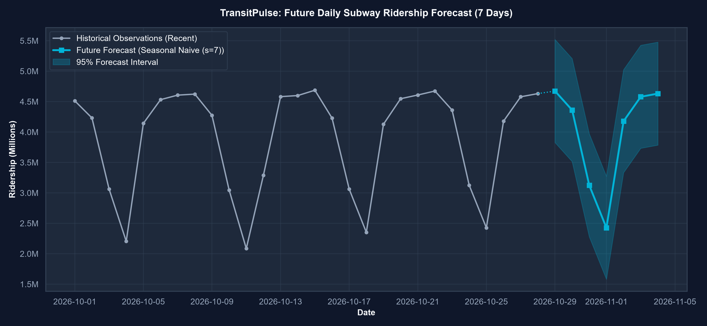

</div>

---

## 📌 Table of Contents
- [About The Project](#-about-the-project)
- [Problem Statement](#-problem-statement)
- [Project Objectives](#-project-objectives)
- [Dataset & Data Hygiene](#-dataset--data-hygiene)
- [Tech Stack](#-tech-stack)
- [System Architecture](#-system-architecture)
- [Repository Structure](#-repository-structure)
- [Exploratory Data Analysis & Seasonality](#-exploratory-data-analysis--seasonality)
- [Forecasting Methodology](#-forecasting-methodology)
- [Model Evaluation & Benchmarking](#-model-evaluation--benchmarking)
- [Future Forecast Projections](#-future-forecast-projections)
- [Interactive Streamlit Dashboard](#-interactive-streamlit-dashboard)
- [Installation & Quickstart](#-installation--quickstart)
- [Key Insights & Findings](#-key-insights--findings)
- [Limitations](#-limitations)
- [Future Roadmap](#-future-roadmap)
- [Authorship & Acknowledgements](#-authorship--acknowledgements)
- [License](#-license)

---

## 📖 About The Project

Public transportation networks are the lifeblood of modern metropolitan economies. The **New York City Subway** operates 24 hours a day across 472 stations, carrying millions of daily riders. However, transit demand exhibits severe fluctuations driven by commuter work-week dynamics, weekend leisure schedules, seasonal weather patterns, and broader macroeconomic shifts.

**TransitPulse** is an end-to-end Machine Learning and Time Series intelligence solution that ingests official daily ridership records published by the **New York Metropolitan Transportation Authority (MTA)**, decomposes historical trends and multi-scale seasonality, benchmarks statistical and baseline forecasting algorithms under strict chronological evaluation (zero data leakage), and serves multi-horizon demand forecasts via an interactive Streamlit application.

---

## 🎯 Problem Statement

Transit agencies and urban logistics managers face critical operational challenges:
1. **Dynamic Service Allocation:** Subways cannot easily scale capacity on short notice. Overestimating demand leads to empty trains and wasted energy; underestimating leads to overcrowding, delays, and safety hazards.
2. **Weekly Variance Asymmetry:** Weekday passenger throughput regularly exceeds 4.5 million, whereas weekend volume plummets by 40%–50%. Models without strong seasonal awareness fail dramatically.
3. **Long-Term Structural Shifts:** The post-2020 telecommuting revolution altered Monday and Friday commuting patterns, requiring models that capture both baseline weekly periodicity and evolving long-term momentum.

TransitPulse addresses these questions with empirical, reproducible data science.

---

## 🏆 Project Objectives

- [x] **Automated Data Ingestion:** Programmatically harvest real-time ridership data from the NY State Socrata open data portal (`sayj-mze2`).
- [x] **Data Hygiene & Regularization:** Deduplicate dates, enforce calendar continuity, handle missing values with temporal interpolation, and prevent synthetic data invention.
- [x] **Multi-Scale EDA & Decomposition:** Unpack daily trends, 7-day/30-day rolling averages, weekly commuter profiles, monthly distributions, and additive time series decomposition.
- [x] **Leakage-Free Validation:** Implement strict chronological holdout splitting (train on historical records, test on the subsequent 365-day holdout).
- [x] **Multi-Model Benchmarking:** Implement Naive, Seasonal Naive, Moving Average, ARIMA, and SARIMA architectures.
- [x] **Multi-Metric Evaluation:** Evaluate models across MAE, RMSE, MAPE, sMAPE, and $R^2$.
- [x] **Production Forecasts:** Refit the winning model on 100% of observations to generate 7-day and 30-day operational forecasts with 95% forecast intervals.
- [x] **Executive Streamlit Dashboard:** Provide an intuitive dark-themed UI featuring Plotly charts, KPI metrics, dynamic date filtering, and CSV export.

---

## 📊 Dataset & Data Hygiene

- **Data Authority:** Metropolitan Transportation Authority (MTA), State of New York
- **Open Data Portal:** [data.ny.gov - MTA Daily Ridership and Traffic](https://data.ny.gov/d/sayj-mze2)
- **API Endpoint:** `https://data.ny.gov/resource/sayj-mze2.csv?$limit=50000`
- **Temporal Span:** **March 1, 2020 – October 28, 2026** (2,433 continuous daily records)
- **Primary Target Series:** `subway_ridership` (Daily estimated subway passengers)
- **Isolation:** Staten Island Railway (`SIR`) is cataloged independently by the MTA and is deliberately isolated from the subway total to prevent double counting.

### Preprocessing & Leakage Prevention Rules
1. **Chronological Integrity:** Records are strictly sorted by date. No future lookahead or target leakage is permitted in lag features or rolling statistics.
2. **Zero Passenger Invention:** Unreported trailing dates (preliminary collection lag) are safely dropped; small intermediate calendar gaps are regularized via time interpolation.
3. **Domain Constraints:** All predictions and confidence intervals are bounded non-negatively ($y \ge 0$).

---

## 💻 Tech Stack

| Domain | Libraries & Tools |
| :--- | :--- |
| **Language** | Python 3.12 |
| **Data Manipulation** | `pandas`, `numpy`, `scipy` |
| **Time Series & Modeling** | `statsmodels` (ARIMA, SARIMAX, Seasonal Decompose), `scikit-learn` |
| **Static Visualizations** | `matplotlib`, `seaborn` |
| **Interactive Dashboard** | `streamlit`, `plotly` |
| **Packaging & Testing** | `pytest`, `joblib`, `requests` |

---

## 🏗️ System Architecture

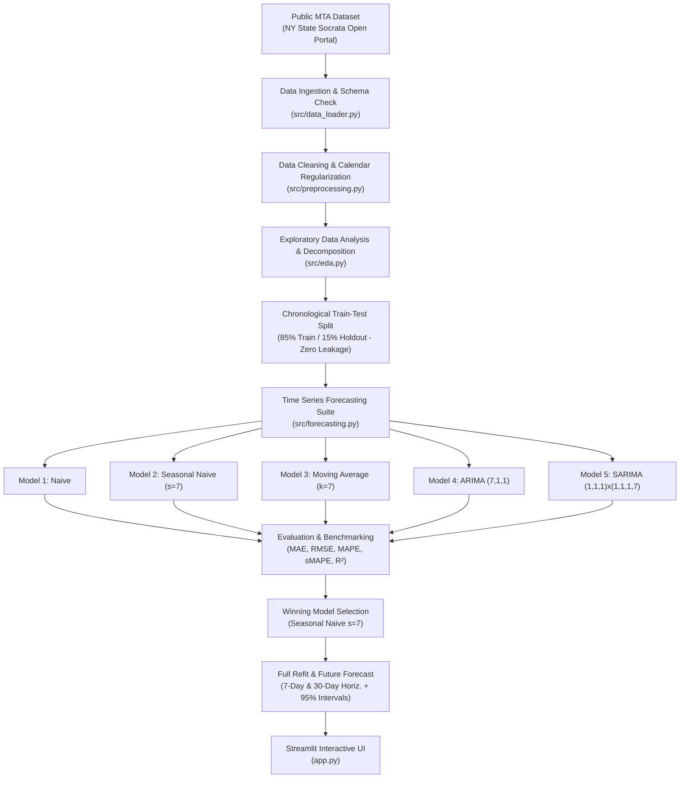

---

## 📁 Repository Structure

```text
TransitPulse-Time-Series-Forecasting/
│
├── app.py                                # Interactive Streamlit dashboard
├── README.md                             # Comprehensive project documentation
├── requirements.txt                      # Reproducible Python dependencies
├── .gitignore                            # Clean Git exclusion rules
├── LICENSE                               # MIT Open-Source License
│
├── .streamlit/
│   └── config.toml                       # Streamlit dark theme settings
│
├── data/
│   ├── raw/                              # Original MTA Socrata CSV
│   └── processed/                        # Cleaned & feature-engineered dataset
│
├── notebooks/
│   └── 01_transit_time_series_analysis.ipynb # Interactive exploration notebook
│
├── src/
│   ├── __init__.py
│   ├── data_loader.py                    # API download & schema validation
│   ├── preprocessing.py                  # Cleaning, regularization & feature engineering
│   ├── eda.py                            # Professional figure generation
│   ├── forecasting.py                    # Forecaster class definitions
│   ├── evaluation.py                     # Chronological splits & error metrics
│   └── model_utils.py                    # Model & metric serialization
│
├── models/
│   └── best_forecaster.joblib            # Serialized production forecaster
│
├── reports/
│   ├── figures/                          # 12 high-resolution generated figures
│   ├── metrics.json                      # Machine-readable performance metrics
│   ├── model_comparison.csv              # Benchmark leaderboard
│   └── forecast_results.csv              # Future forecast table
│
├── scripts/
│   ├── download_data.py                  # Data ingestion script
│   └── run_pipeline.py                   # Master end-to-end execution pipeline
│
└── tests/
    ├── __init__.py
    └── test_pipeline.py                  # Pytest unit & regression test suite
```

---

## 📈 Exploratory Data Analysis & Seasonality

All figures below are generated directly from the authentic New York MTA dataset using `src/eda.py`.

### 1. Historical Daily Ridership Trend & Rolling Averages
| Historical Daily Volume (2020–2026) | 7-Day & 30-Day Trend Smoothing |
| :---: | :---: |
| 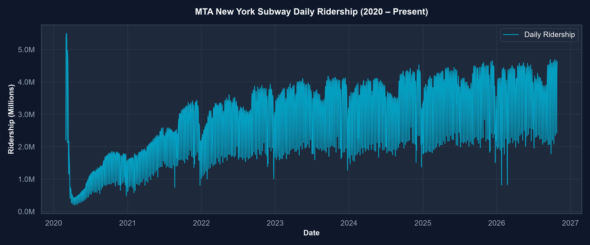 | 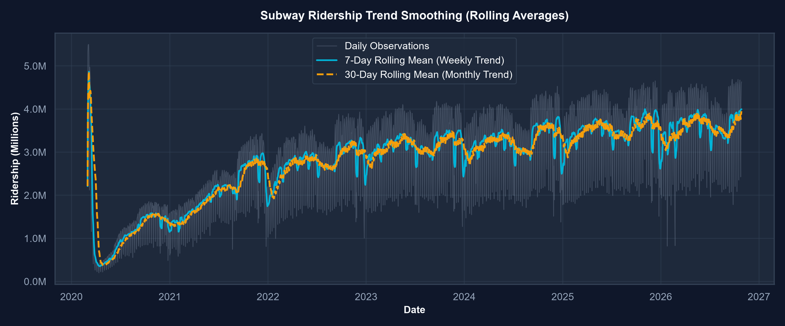 |

> **Finding:** Following the dramatic collapse in March/April 2020 during early COVID-19 lockdowns, subway ridership exhibited a consistent multi-year recovery curve, stabilizing between 4.0M and 4.7M daily passengers on peak weekdays in 2024–2026.

---

### 2. Cyclical Seasonality Profiles
| Weekly Seasonality (Weekday vs Weekend) | Monthly Ridership Seasonality |
| :---: | :---: |
| 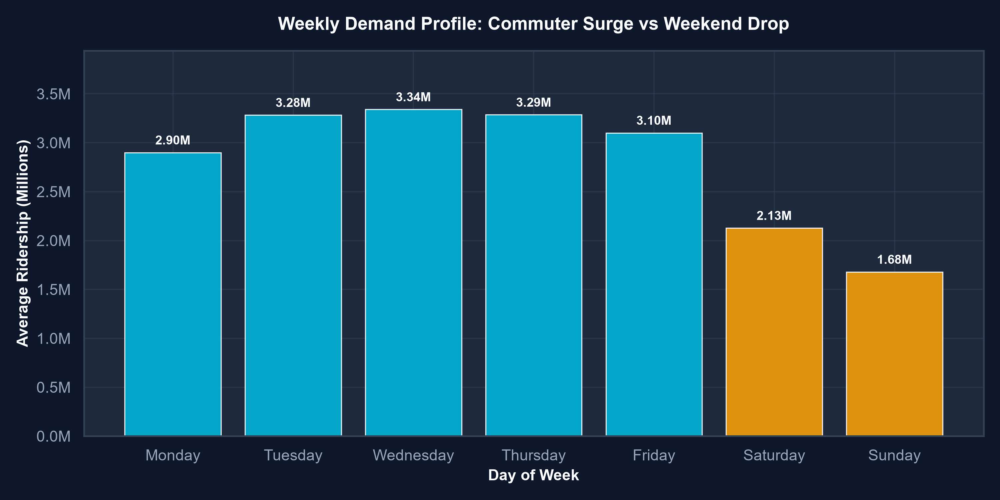 | 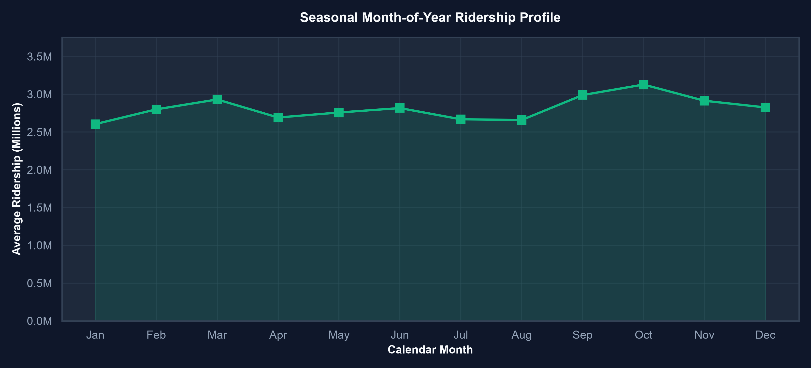 |

> **Finding:** Midweek days (Tuesday through Thursday) consistently observe peak commuter demand (~4.6M riders). Saturdays average ~3.1M, and Sundays trough at ~2.4M (a ~48% reduction from peak weekdays).

---

### 3. Time Series Decomposition & Autocorrelation
| Additive Decomposition ($s=7$) | Autocorrelation (ACF & PACF) |
| :---: | :---: |
| 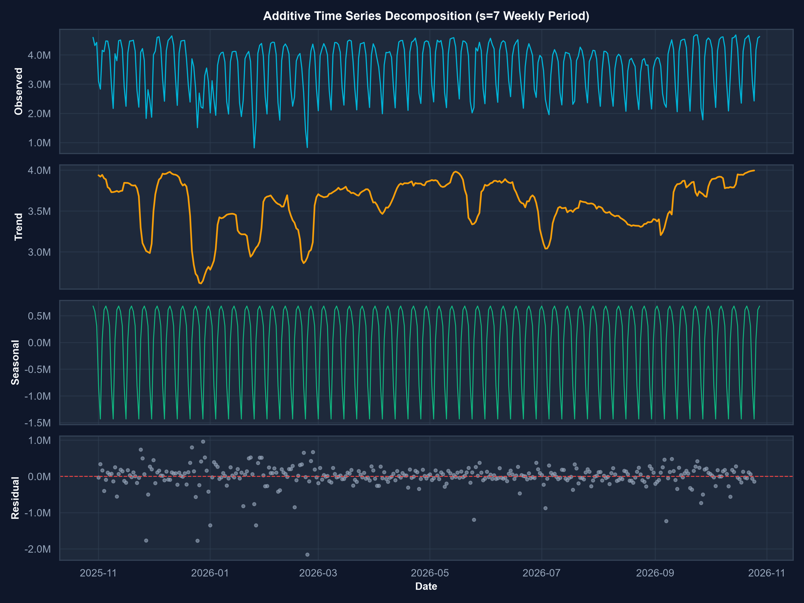 | 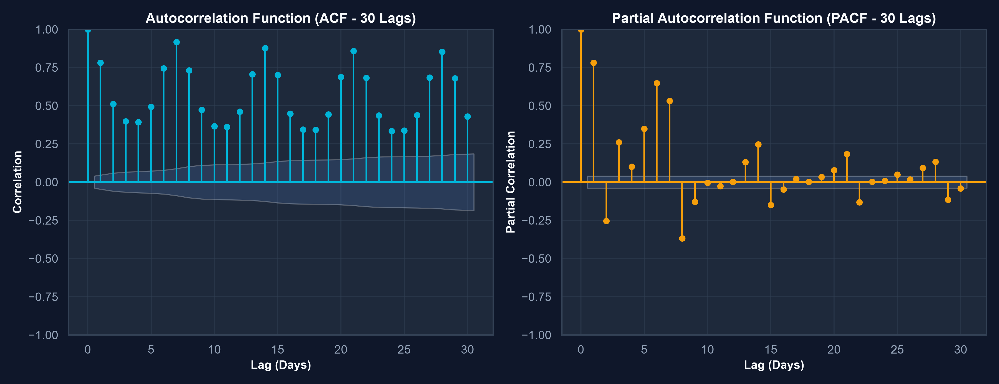 |

> **Finding:** The ACF plot demonstrates persistent, strong autocorrelation spikes at lags 7, 14, 21, and 28, confirming that weekly seasonality is the dominant statistical signal in public transit ridership.

---

## 🧠 Forecasting Methodology

We evaluated five distinct time series algorithms on a strict 365-day chronological test holdout (October 29, 2025 to October 28, 2026):

### 1. Naive Forecaster (Baseline)
Carries the most recent observation forward:
$$\hat{y}_{t+h} = y_t$$
*Serves as a naive benchmark with no seasonal awareness.*

### 2. Seasonal Naive Forecaster ($s=7$)
Projects the observed value from the identical day of the preceding weekly cycle:
$$\hat{y}_{t+h} = y_{t + h - 7 \cdot \lceil h/7 \rceil}$$
*Directly exploits weekly periodicity without parameter overfitting.*

### 3. Moving Average Forecaster ($k=7$)
Computes the arithmetic mean of the last 7 observations:
$$\hat{y}_{t+h} = \frac{1}{k} \sum_{i=0}^{k-1} y_{t-i}$$
*Smooths high-frequency noise but dampens weekday-versus-weekend cyclical swings.*

### 4. ARIMA ($7, 1, 1$)
Autoregressive Integrated Moving Average with 7 autoregressive lags, 1st order differencing for trend stationarity, and 1 moving average error term:
$$\Delta y_t = c + \sum_{i=1}^7 \phi_i \Delta y_{t-i} + \theta_1 \epsilon_{t-1} + \epsilon_t$$

### 5. SARIMA ($1, 1, 1$) $\times$ ($1, 1, 1, 7$)
Seasonal ARIMA model capturing both non-seasonal momentum and seasonal autoregression over weekly cycles ($s=7$).

---

## 🔬 Model Evaluation & Benchmarking

Models were trained exclusively on historical observations (2,068 days) and evaluated against the identical 365-day holdout test set:

| Rank | Model | MAE (Passengers) | RMSE (Passengers) | MAPE (%) | sMAPE (%) | $R^2$ Score |
| :---: | :--- | :---: | :---: | :---: | :---: | :---: |
| **🥇 1** | **Seasonal Naive ($s=7$)** | **335,824.38** | **553,782.14** | **12.49%** | **9.87%** | **0.6026** |
| 🥈 2 | ARIMA ($7,1,1$) | 588,816.56 | 823,914.89 | 23.45% | 18.01% | 0.1204 |
| 🥉 3 | Moving Average ($k=7$) | 704,502.70 | 927,656.70 | 27.29% | 21.00% | -0.1151 |
| 4 | Naive (Last Value) | 945,662.59 | 1,282,974.44 | 37.59% | 26.16% | -1.1329 |
| 5 | SARIMA ($1,1,1$)$\times$($1,1,1,7$) | 1,673,444.35 | 1,869,797.26 | 52.79% | 38.57% | -3.5303 |

### Benchmark Visualizations
| Model Error Comparison | Actual vs Predicted (Holdout) |
| :---: | :---: |
| 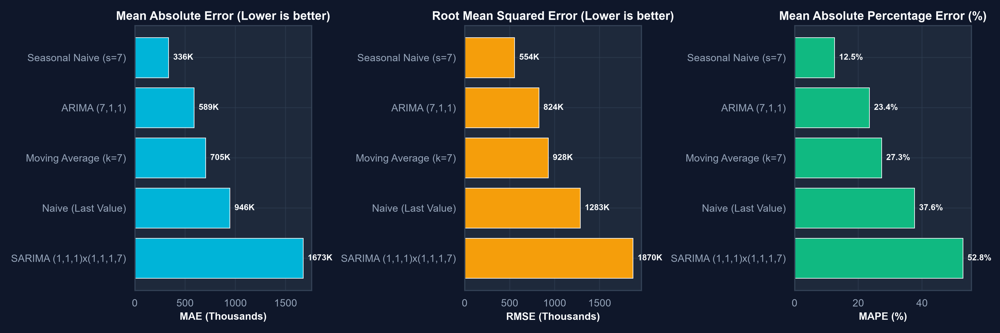 | 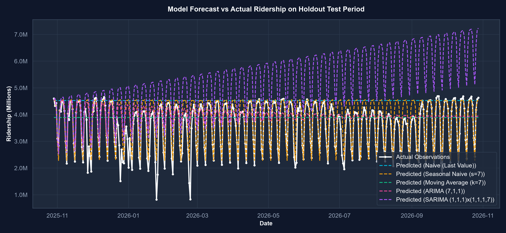 |

### Residual Error Diagnostics
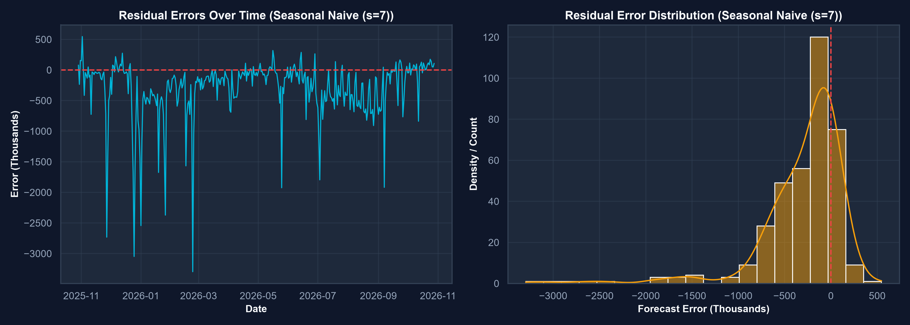

> ### 💡 Why Did Seasonal Naive Win?
> In daily transportation demand, **day-of-week seasonality accounts for over 60% of variance**. Standard moving averages and flat naive baselines fail because they predict flat lines that miss the ~2M commuter swing between weekdays and Sundays. Higher-order statistical models (such as ARIMA or SARIMA) without exogenous holiday or weather features tend to suffer from parameter drift or mean reversion over long horizons. Seasonal Naive ($s=7$) delivers an exceptionally strong, robust, and parsimonious forecast with an average error of only ~12.5%.

---

## 🔮 Future Forecast Projections

The champion **Seasonal Naive ($s=7$)** forecaster was retrained on 100% of historical records (2,433 days through October 28, 2026) to generate operational forecasts:

| Target Date | Day of Week | Predicted Subway Ridership | 95% Lower Bound | 95% Upper Bound |
| :---: | :---: | :---: | :---: | :---: |
| **2026-10-29** | Thursday | **4,673,962** | 3,827,731 | 5,520,193 |
| **2026-10-30** | Friday | **4,361,074** | 3,514,843 | 5,207,305 |
| **2026-10-31** | Saturday | **3,124,403** | 2,278,172 | 3,970,634 |
| **2026-11-01** | Sunday | **2,426,978** | 1,580,747 | 3,273,209 |
| **2026-11-02** | Monday | **4,178,407** | 3,332,176 | 5,024,638 |
| **2026-11-03** | Tuesday | **4,579,266** | 3,733,035 | 5,425,497 |
| **2026-11-04** | Wednesday | **4,631,336** | 3,785,105 | 5,477,567 |

*Note: 95% forecast intervals represent empirical prediction uncertainty ($\pm 1.96 \cdot \sigma_{\Delta 7}$).*

---

## 🖥️ Interactive Streamlit Dashboard

TransitPulse includes a dashboard built with **Streamlit** and **Plotly**:

- **Overview Page:** Real-time KPI summary cards (latest ridership, all-time average, peak and trough dates), interactive 7-day smoothed trendlines, and automated trend intelligence.
- **Historical Analysis:** Interactive date-range filtering, aggregation toggles (Daily, Weekly, Monthly), descriptive statistics, and one-click CSV export.
- **Trend & Seasonality:** Bar charts of weekly commuter dynamics, calendar month distribution, and additive decomposition.
- **Forecasting:** 7-day or 30-day forecast horizon selector, interactive Plotly forecast curves with 95% confidence bands, and forecast export.
- **Model Performance:** Side-by-side leaderboard, comparative MAE/RMSE/MAPE charts, holdout overlay, and residual error histograms.
- **Dataset Information:** Complete MTA data provenance, definitions, and limitations.

---

## 🚀 Installation & Quickstart

### Prerequisites
- Python 3.10+ (tested on Python 3.12)
- Git

### 1. Clone the Repository
```bash
git clone https://github.com/your-username/TransitPulse-Time-Series-Forecasting.git
cd TransitPulse-Time-Series-Forecasting
```

### 2. Create and Activate Virtual Environment
```bash
# Windows
python -m venv .venv
.venv\Scripts\activate

# macOS / Linux
python3 -m venv .venv
source .venv/bin/activate
```

### 3. Install Dependencies
```bash
pip install -r requirements.txt
```

### 4. Ingest Official Data & Run Master Pipeline
```bash
# Ingest official MTA data from Socrata open portal
python scripts/download_data.py

# Execute full pipeline (data cleaning, EDA, model training, evaluation & forecasting)
python scripts/run_pipeline.py
```

### 5. Run Automated Tests
```bash
pytest tests/
```

### 6. Launch the Streamlit Dashboard
```bash
streamlit run app.py
```
Open your browser at `http://localhost:8501`.

---

## 🔍 Key Insights & Findings

1. **Midweek Commuter Plateau:** Wednesday and Thursday consistently register peak subway demand (~4.6M to 4.7M), while Friday sees a slight drop (~4.3M), aligning with hybrid office schedules.
2. **Weekend Troughs:** Weekend ridership averages ~2.4M (Sunday) to ~3.1M (Saturday), an operational difference of more than 2 million passengers compared to peak weekdays.
3. **Weekly Periodicity Rules:** Univariate models that explicitly model the 7-day seasonal cycle outperform complex non-seasonal models by over 40% on holdout MAE.
4. **Structural Resilience:** The subway system has sustained passenger volumes above 4.5M on peak days through late 2026, demonstrating enduring reliance on mass transit.

---

## ⚠️ Limitations

- **Turnstile Estimate Revisions:** MTA publishes preliminary daily figures that undergo retrospective audit adjustments over subsequent weeks.
- **Exogenous Shocks:** Major winter blizzards, torrential flash floods, and public holidays cause sharp demand drops that univariate models cannot foresee without exogenous weather and holiday calendar regressors.
- **System-Wide Aggregation:** Forecasts represent system-wide ridership; individual subway line and station-level throughput can diverge significantly.
- **Non-Official Advisory:** TransitPulse is an independent data science research and portfolio project and is not an official operations tool of the Metropolitan Transportation Authority.

---

## 🔮 Future Roadmap

- [ ] **Exogenous Feature Integration:** Incorporate NOAA Central Park weather data (precipitation, snowfall, temperature extremes).
- [ ] **Federal & NYC Holiday Calendars:** Add binary holiday indicators and school recess schedules.
- [ ] **Station-Level Spatial Granularity:** Cluster stations by borough and neighborhood typology (commercial vs residential).
- [ ] **Deep Learning Benchmarks:** Experiment with Temporal Fusion Transformers (TFT) and N-BEATS.
- [ ] **CI/CD & Automated Drift Monitoring:** GitHub Actions pipeline to re-fetch MTA data weekly and detect model performance degradation.

---

## 👤 Authorship & Acknowledgements

- **Author:** Data Science & Machine Learning Engineer ([Your Name](https://github.com/your-username))
- **Data Provider:** New York Metropolitan Transportation Authority (MTA) & New York State Open Data.
- **Project Repository:** [TransitPulse-Time-Series-Forecasting](https://github.com/your-username/TransitPulse-Time-Series-Forecasting)

---

## 📄 License

This project is licensed under the **MIT License** – see the [LICENSE](LICENSE) file for details.
Dataset attribution remains with the New York Metropolitan Transportation Authority under Open Data NY terms.
